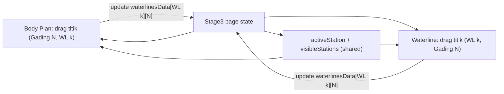

# Plan: Editor Body Plan Per-Gading yang Tersinkron dengan Waterline

> [!IMPORTANT]
> **ATURAN UNTUK AI YANG MENGERJAKAN PLAN INI**
> 1. Kerjakan **SATU FASE SAJA** per sesi. Jangan mulai fase berikutnya sebelum user menyetujuinya.
> 2. Di akhir setiap fase, **BERHENTI**, laporkan hasilnya (file yang diubah, screenshot/cara uji), lalu **minta review dari user**.
> 3. Lanjut ke fase berikutnya **hanya** setelah user menulis persetujuan yang jelas (mis. "lanjut phase 2" / "approved").
> 4. Jika user minta revisi, perbaiki di fase yang sama dulu, lalu minta review lagi.
> 5. Centang checklist `[x]` di file ini setiap tugas selesai, dan isi bagian **Status Review**.
> 6. Jangan ubah perilaku fitur lain (Side Profile, CSA, Lines Plan Three-View) di luar cakupan fase.

---

## 1. Tujuan

1. **Lengkungan Body Plan bisa diedit** per gading (station), bukan hanya Gading 10 (midship).
2. **Korelasi dua arah**: edit gading N di Body Plan → titik gading N di semua Waterline ikut berubah; edit di Waterline → kurva gading di Body Plan ikut berubah.
3. **Pilih gading yang diedit**, konsepnya sama dengan "Select Waterline" yang sudah ada.
4. **Visibilitas gading**: user bisa menampilkan hanya gading tertentu dan menyembunyikan yang lain.

## 2. Kondisi Kode Saat Ini (hasil analisis)

| Item | Lokasi | Catatan |
|---|---|---|
| Sumber data bersama | `frontend/src/app/projects/[projectId]/stage3/page.tsx` | `waterlinesData: Record<wlId, Record<station, halfBreadth>>` + `activeWlId` sudah di-*lift* ke page dan dioper ke kedua komponen |
| Editor Waterline | `frontend/src/components/design/WaterPlaneCalculationSheet.tsx` | Sudah ada "Select Waterline", drag titik per station (`draggingStation`) |
| Body Plan | `frontend/src/components/design/MidshipBilgeCalculationSheet.tsx` | `studioMode: "bodyPlan" \| "xyzTable" \| "midshipDetail"`; kurva gading dibangun dari `getStationHalfB(st, wlId, z)` |
| Drag Body Plan saat ini | `MidshipBilgeCalculationSheet.tsx` `handlePointerMove` (~baris 1213) | **Terbatas**: drag di-hardcode `setDraggingStation(10.0)` dan menyalin nilai ke St 6–15 (PMB) |
| Harmonizer | `frontend/src/components/design/UnifiedWaterplaneBilgeHarmonizer.tsx` | Punya `selectedStation` lokal — bisa dijadikan referensi pola |

**Kesimpulan desain:** korelasi dibangun di atas `waterlinesData` yang sudah ada. Satu titik edit di Body Plan = satu sel `waterlinesData[wlId][station]`. Karena Waterline membaca data yang sama, sinkronisasi otomatis terjadi tanpa model data baru.

---

## Phase 1 — Fondasi State: Pilihan Gading & Visibilitas

**Tujuan:** menyiapkan state bersama tanpa mengubah perilaku edit dulu.

- [x] Tambah state di `stage3/page.tsx`:
  - `activeStation: number` (default `10`)
  - `visibleStations: number[] | "all"` (default `"all"`)
- [x] Tambah prop opsional ke `MidshipBilgeCalculationSheet` dan `WaterPlaneCalculationSheet`: `activeStation`, `onSelectStation`, `visibleStations`, `onUpdateVisibleStations` (dengan fallback state lokal agar komponen tetap jalan jika prop tidak dioper).
- [x] Oper prop tersebut di **semua** tempat kedua komponen dirender di `page.tsx` (ada beberapa instance: tab waterplaneBilge, fullscreen dual, dll.).
- [x] Simpan `activeStation` & `visibleStations` ke payload `handleSaveAll` dan muat kembali saat load (server + localStorage fallback).
- [x] Pastikan `npx tsc --noEmit` lolos dan tidak ada perubahan visual.

**Kriteria selesai:** aplikasi tampil identik seperti sebelumnya; state baru ada dan tersimpan.

> 🛑 **STOP — Minta review user sebelum lanjut ke Phase 2.**

**Status Review Phase 1:** _Selesai dikerjakan (Menunggu Review & Persetujuan User)_

---

## Phase 2 — UI "Select Station" & Toggle Visibilitas Gading di Body Plan

**Tujuan:** user bisa memilih gading aktif dan menyembunyikan gading lain.

- [x] Tambah toolbar **"Select Station (N):"** di mode Body Plan, gaya visual sama dengan "Select Waterline" (chip per gading: `AP, 0, ½, 1, … 10 … 19½, 20, FP`, pakai `getStationDisplayLabel`).
- [x] Klik chip → set `activeStation`. Gading aktif di-*highlight* (warna aksen + stroke lebih tebal); gading lain diredupkan.
- [x] Klik langsung pada kurva gading di SVG juga memilih gading tersebut (disertai transparent hit area untuk kemudahan klik).
- [x] Panel **visibilitas gading**:
  - Ikon mata per chip untuk show/hide (`Eye` / `EyeOff`).
  - Tombol cepat: `Semua`, `Hanya Aktif`, `Buritan (0–10)`, `Haluan (10–20)`.
  - Gading tersembunyi **tidak dirender sama sekali** (bukan hanya transparan).
- [x] Gading aktif tidak boleh ikut tersembunyi (otomatis tampil jika dipilih).
- [x] Label info: `Gading 10 • 21 dari 21 tampil`.

**Kriteria selesai:** pilih gading & sembunyikan gading berfungsi; belum ada editing baru.

> 🛑 **STOP — Minta review user sebelum lanjut ke Phase 3.**

**Status Review Phase 2:** _Selesai dikerjakan (Menunggu Review & Persetujuan User)_

---

## Phase 3 — Editing Lengkungan Gading di Body Plan

**Tujuan:** lengkungan gading aktif bisa diedit dengan drag titik kontrol.

- [x] Render **titik kontrol** pada gading aktif, satu titik di setiap perpotongan dengan waterline (`z = wl.draftFraction * T`), plus garis penuntun dan highlight titik aktif/hover.
- [x] Refactor `handlePointerMove`:
  - Hapus hardcode `setDraggingStation(10.0)` → gunakan `activeStation` / `draggingStation`.
  - Drag horizontal mengubah `waterlinesData[wlId][activeStation]` (half-breadth), dibatasi `0 … halfB * 1.15`.
  - Perilaku lama "Gading 10 menyalin ke St 6–15 (PMB)" dijadikan **opsi toggle** `Kunci PMB (St 6–15)` (default ON untuk menjaga perilaku lama, toggleable ke OFF).
- [x] Sisi kiri (afterbody, st ≤ 10) dan kanan (forebody, st > 10) dipetakan secara akurat terhadap Centerline (`ox = 100`).
- [x] Kontrol presisi CAD: input angka numerik langsung + tombol penyesuaian langkah cepat `±0.01` (1 cm) dan `±0.1` (10 cm).
- [x] Tooltip saat drag/hover: `Gading [st] @ [wl] (Z=...m) -> 0.5B = ...m (Drag horizontal)`.
- [x] Tombol `Reset Gading` untuk mengembalikan gading aktif ke nilai teoritis (menghapus modifikasi lokal pada station tersebut di `waterlinesData`).
- [x] Tersedia konsisten pada tampilan Body Plan standar maupun mode Fullscreen.

**Kriteria selesai:** drag titik gading mana pun mengubah bentuknya dan data tersimpan di `waterlinesData`.

> 🛑 **STOP — Minta review user sebelum lanjut ke Phase 4.**

**Status Review Phase 3:** _Selesai dikerjakan (Menunggu Review & Persetujuan User)_

---

## Phase 4 — Sinkronisasi Dua Arah Body Plan ↔ Waterline & Finalisasi

**Tujuan:** korelasi penuh dan kalkulasi ikut terbarui.

- [x] **Body Plan → Waterline:** edit gading N di Body Plan langsung menggeser titik station N di plot Waterline (semua WL yang terkena), tanpa reload.
- [x] **Waterline → Body Plan:** drag titik station N di Waterline langsung mengubah kurva gading N di Body Plan secara real-time.
- [x] **Seleksi tersinkron:** memilih station di Waterline ikut mengubah `activeStation` di Body Plan, dan sebaliknya. Penanda visual (garis pandu CAD vertikal + pulsing outer ring + label gading `▲ St.N`) di plot Waterline menunjukkan gading aktif.
- [x] Opsi visibilitas gading diterapkan ke plot Waterline dengan toggle `Filter Body Plan: ON/OFF`.
- [x] Baris tabel kalkulasi Simpson Waterline otomatis ter-highlight saat gading dipilih, dan klik baris tabel langsung memilih gading tersebut.
- [x] Kalkulasi turunan real-time: AWL, LCF, IT/IL (Waterplane), luas penampang gading ($A_m$ / CSA), dan XYZ Offsets table terbarui otomatis.
- [x] Peringatan non-blocking fairing advisory bila lengkungan gading mengalami penurunan lebar tak wajar pada sarat yang lebih tinggi.
- [x] Penyimpanan otomatis & manual via tombol `Simpan / Ctrl+S` dengan persistensi database backend dan localStorage fallback.
- [x] `npx tsc --noEmit` dan `npm run build` lolos tanpa error (Exit Code 0).

**Kriteria selesai:** edit di salah satu tampilan selalu tercermin di tampilan lain dan di kalkulasi.

> 🛑 **STOP — Minta review akhir user.**

**Status Review Phase 4:** _Selesai dikerjakan (Menunggu Review Akhir User)_

---

## Risiko & Catatan

- `WaterPlaneCalculationSheet.tsx` (~247 KB) dan `MidshipBilgeCalculationSheet.tsx` (~162 KB) sangat besar → edit harus kecil dan terarah; hindari menulis ulang file.
- Ada **beberapa instance** komponen di `page.tsx` (tab normal & mode fullscreen ganda) — semuanya harus menerima prop baru.
- Key station berupa angka desimal (`0.5`, `19.5`, `20.5`) → perhatikan konsistensi key `number` vs `string` di `Record`.
- Perilaku lama "kunci PMB" harus tetap tersedia agar desain yang sudah tersimpan tidak berubah tak terduga.
